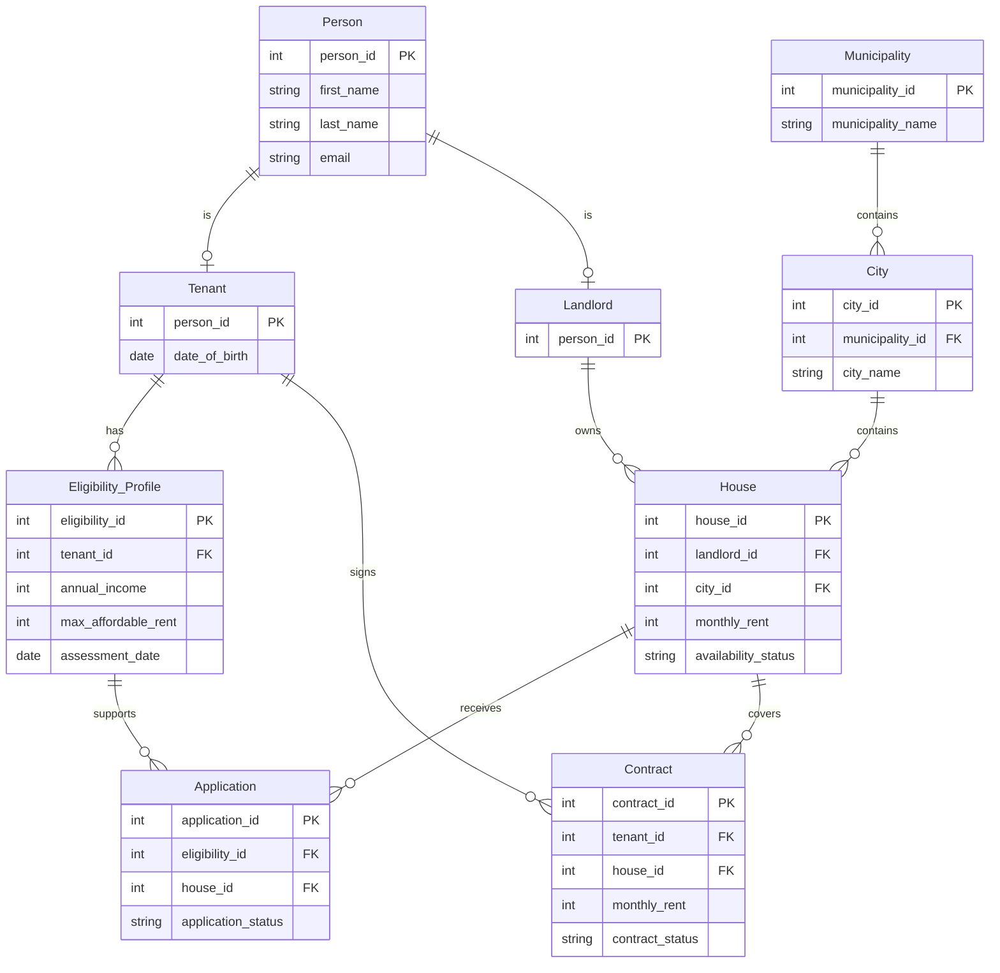
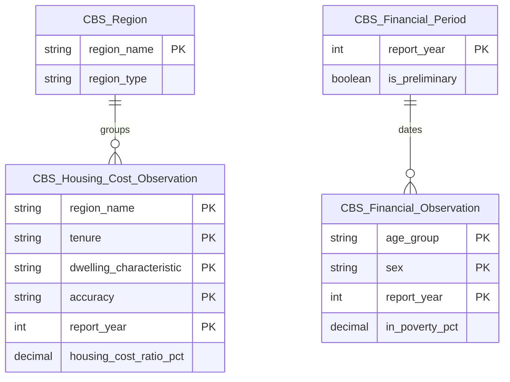

# Current database ERD

This diagram shows the current schema's keys and main analysis fields. The [Week 2 PDF](ERD_Diagram.pdf) records the earlier design; the SQL files are authoritative for full column definitions and constraints.

An application's tenant is identified by its eligibility profile. `Application` does not store a second tenant ID.

